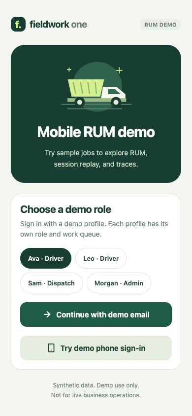
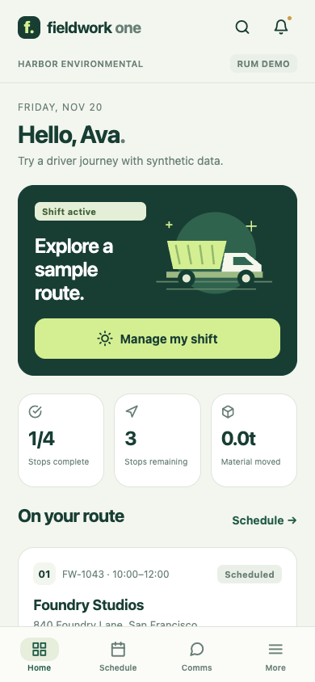
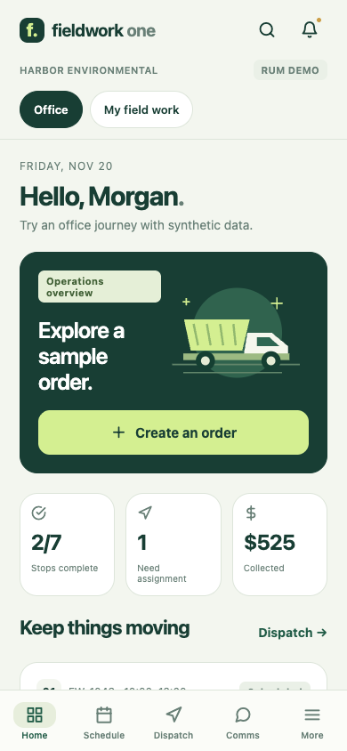
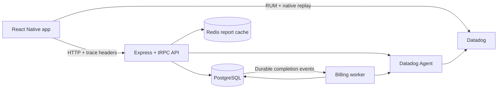

# Fieldwork One: mobile observability demo

A React Native sample for learning and testing Datadog RUM, Session Replay, and API tracing on iOS and Android. Synthetic driver and office tasks generate navigation, taps, network requests, errors, offline retries, and background traces.

**This is an observability teaching workload, not software for running a field-service business or replacing a commercial operations platform.** Use synthetic data only. The sample has fixed demo accounts, simulated payments and calls, and simplified storage. It has no production identity system or tenant provisioning.

All names, sites, records, service identifiers, and assets are synthetic. The app has no dependency on a customer environment. See the [scope and capability guide](docs/CAPABILITIES.md) for the remaining limits.

<p>
  
  
  
</p>

These images show the browser preview at a phone screen size.

## Start the browser preview

Use Node 22.20.0 and npm. Datadog credentials are optional.

```sh
cd datadog/fieldwork-mobile-demo
nvm use
cp .env.example .env
npm ci
npm run dev
```

Open <http://localhost:8081>. The API runs at <http://localhost:4310>. Select **Ava · Driver** or **Morgan · Admin**, then select **Continue with demo email**. The phone sign-in uses the displayed code `123456`; it sends no SMS.

The default API stores records in `data/state.json`. It runs the billing worker in the same process. Stop both processes with Ctrl+C. Keep the file to retain records across restarts. To start a separate sample dataset, set `DATA_FILE` to a new path before you start the API.

The browser preview uses the same screens and workflows. Native SDK behavior, native permissions, and native Session Replay must be checked on an iOS or Android build.

The native app stores offline snapshots and photo queues in SQLite. It stores the session credential in SecureStore. The browser preview uses browser storage, which has smaller size limits. Use the synthetic photo for browser walkthroughs with many uploads.

## Install on a phone

Use the [short installation guide](docs/INSTALL.md). Run `npm run setup:device`, start `npm run api:device`, then run `npm run install:android` or `npm run build:ios`. For iPhone, use `npm run prepare:ios` once to select your signing team in Xcode.

For Android, the command builds the APK and starts the QR server. Scan the QR code with the phone camera to download the APK. Use `npm run serve:android` to share an existing APK without rebuilding.

Builds run locally with Android SDK/JDK or Xcode/CocoaPods. The resulting app runs without Metro. Install the APK directly on Android. The iOS command installs on a connected, signed device. Toolchain setup, Apple signing, and phone permissions require user input. See the [build reference](docs/BUILDING.md).

## Sample workflows for telemetry

These connected exercises make telemetry easier to inspect. They are not a product feature roadmap or a claim of parity with commercial software.

| Area           | Working sample behavior                                                                                                                      |
| -------------- | -------------------------------------------------------------------------------------------------------------------------------------------- |
| Identity       | Four demo profiles, email-style sign-in, phone-code flow, signed sessions, driver and office permissions                                     |
| Driver day     | Truck selection, six-point inspection, defect reporting, clock-in, breaks, clock-out, shift history                                          |
| Schedule       | Date and status filters, stop details, site instructions, maps link, current-location permission                                             |
| Jobs           | Delivery, pickup, swap, live load, container confirmation, required photo checks, disposal weight and site, completion notes, recipient name |
| Evidence       | Camera, photo library, synthetic photo, upload limit, office verification                                                                    |
| Exceptions     | Blocked jobs, dispatch resolution, maintenance status, safe-inspection requirements                                                          |
| Dispatch       | Create orders, set prices and priority, assign or move orders to the first or last route position                                            |
| Customers      | Search, contacts, addresses, site notes, service history, account balance                                                                    |
| Communications | Dispatch chat, team huddles, customer threads, simulated call outcomes                                                                       |
| Billing        | Durable completion events, background invoice creation, partial or full demo payments, payment history                                       |
| Fleet          | Trucks, container inventory, shop tasks, maintenance completion                                                                              |
| Notifications  | Persistent inbox, read status, local device notifications, optional native push-token registration                                           |
| Offline work   | Cached workspace, persistent per-profile action queue, ordered retries, duplicate prevention, rejected-action review                         |
| Observability  | Named views, actions, network requests, errors, feature operations, consent, native replay, backend traces and correlated logs               |

The sample does not implement real SMS, calls, card processing, remote push delivery, route optimization, or live vehicle tracking. The route drawing is an illustration. The recipient field is a name record, not a signature pad. The container model uses one confirmed container per order; it does not model both container movements in a swap. These are explicit sample boundaries.

## Run the service stack

Use Docker Desktop with Compose v2.

```sh
make up
npm run web
```

This starts the API, PostgreSQL, Redis, and a separate billing worker. The API binds to loopback by default. For a phone on your trusted local network, set `API_BIND_HOST=0.0.0.0` and follow the phone-network steps in [INSTALL.md](docs/INSTALL.md).

```sh
make logs
make down
```

`make clean` removes the Compose database volume. It does not remove `data/state.json`, which belongs to the local file-store mode. Do not run the local API and the Compose API on port 4310 at the same time.



The file-store mode has one process. Do not point multiple API or worker processes at the same state file. The PostgreSQL mode uses a transaction and a row lock so API requests and worker updates cannot overwrite each other. Redis stores revision-specific report results for 30 seconds; a cache failure falls back to the database. Photos are bounded JPEG data in the sample state. This keeps setup small but is not a production media-storage design.

## Connect Datadog later

See [DATADOG.md](docs/DATADOG.md). The native client needs a React Native RUM application ID and a client token. The backend Agent and symbol upload need a Datadog API key. Keep API keys out of all `EXPO_PUBLIC_*` variables.

To send native RUM and replay to Oodle instead, see [OODLE.md](docs/OODLE.md).

The app starts with collection disabled. The demo settings screen can pause consent, pause replay, show the RUM session ID, and create healthy, slow, and failed request scenarios. It also captures a handled JavaScript error without crashing the app.

## Walk through the sample

1. Sign in as Ava. Open **Start my day**. Select Truck 12.
2. Open the inspection. Check all six items. Submit a safe inspection, then clock in.
3. Open `FW-1042`. Start the job. Confirm `BOX-201`.
4. Add the sample delivered photo, or use the camera. Complete the job.
5. Open `FW-1044` for a pickup. Confirm `BOX-301`, add a removed photo, and record a disposal weight and site. Complete the job.
6. Open **Comms** and send a dispatch message or team huddle update.
7. Open **More → Pending actions**. Enable offline simulation. Send another message. Return to the queue, disable simulation, and sync.
8. Sign out and sign in as Morgan. Inspect the completed jobs and verify their photos.
9. Open invoices. The worker creates one invoice for each completed job. Record a partial or full demo payment.
10. Create an order for Cedar House. Use Dispatch to assign it to the first or last position on a route.
11. Create a shop task. The truck enters maintenance. Complete the task to restore its ready status.
12. Open **Demo & observability** to create trace and error scenarios after you configure Datadog.

## Checks

```sh
npm run check
npm run export:web
npm run export:native
npx expo-doctor
```

The API tests use temporary state files and real local HTTP requests. They check workflow rules, permissions, retries, payments, persistence, maintenance, and phone-code reuse. They do not use production credentials. See [VALIDATION.md](docs/VALIDATION.md) for the checks completed during implementation and the remaining device checks.

With the Compose stack running, `npm run smoke:stack` checks PostgreSQL retry handling, separate-worker billing, demo payment deduplication, and Redis reports. It creates synthetic records and completes a shift as Leo. Use a demo dataset where Leo has no active job. The included CI workflow runs these checks for changes to this sample.
